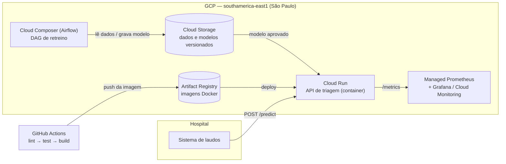

# Triagem Automática de Laudos Médicos — FIAP MLE10 Tech Challenge Fase 03

Serviço de NLP que classifica laudos médicos em **normal**, **atenção** ou **urgente**,
servido por uma API REST (FastAPI) empacotada em Docker. O projeto cobre o ciclo de
vida do modelo em produção: decisão arquitetural de deploy em nuvem, CI/CD, orquestração
de retreino, monitoramento e otimização de latência.

## Sumário

- [Contexto do problema](#contexto-do-problema)
- [Decisão arquitetural de deploy](#decisão-arquitetural-de-deploy)
- [Dados e rotulagem de urgência](#dados-e-rotulagem-de-urgência)
- [Modelo](#modelo)
- [Latência baseline](#latência-baseline)
- [Estrutura do repositório](#estrutura-do-repositório)
- [Como executar](#como-executar)
- [API](#api)
- [Qualidade de código e testes](#qualidade-de-código-e-testes)
- [Etapas do projeto](#etapas-do-projeto)
- [Licença e atribuição](#licença-e-atribuição)

## Contexto do problema

Um hospital de referência recebe um fluxo contínuo de laudos em texto. Quando a fila é
processada por ordem de chegada, um laudo com achado crítico (ex.: sinais de infarto ou
AVC) pode esperar atrás de dezenas de exames de rotina. A triagem automática reordena a
fila pela urgência estimada, para que a equipe clínica veja primeiro o que não pode
esperar. O modelo **apoia** a priorização; a decisão clínica continua sendo humana.

## Decisão arquitetural de deploy

### Real-time ou batch?

| Critério | Real-time (API síncrona) | Batch (lotes agendados) |
|---|---|---|
| Valor da resposta | Alto: a prioridade é útil assim que o laudo é emitido | Baixo: um laudo urgente pode esperar até a próxima janela |
| Volume por requisição | 1 laudo, ~180 palavras | Muitos laudos de uma vez |
| Custo computacional | Inferência de ~1 ms em CPU, sem GPU | Eficiente, mas o ganho é irrelevante nesse custo |
| Integração | Sistema de laudos chama a API ao emitir o exame | Exige fila intermediária e janela de processamento |

**Decisão:** inferência **em tempo real** via API REST para a triagem, e processamento
**batch** apenas para o que não é sensível ao tempo: retreino do modelo e reprocessamento
histórico. O modelo é leve (TF-IDF + regressão logística), então CPU é suficiente e o
gargalo de latência tende a ser rede/serialização, não o modelo.

### Nuvem escolhida: Google Cloud Platform



| Componente | Serviço GCP | Justificativa |
|---|---|---|
| Serviço de inferência | **Cloud Run** | Container stateless, escala automática por requisição, HTTPS e IAM nativos. `min-instances=1` elimina *cold start* — requisito para um fluxo de urgência. |
| Imagens | Artifact Registry | Destino do `docker build` do CI/CD, com varredura de vulnerabilidades. |
| Dados e modelos | Cloud Storage | Versionamento de objetos; o retreino grava o modelo e a API carrega a versão aprovada. |
| Retreino | Cloud Composer (Airflow gerenciado) | Mesma DAG desenvolvida localmente roda sem reescrita. |
| Observabilidade | Managed Service for Prometheus + Grafana | Reaproveita a instrumentação `prometheus_client` e os dashboards locais. |

**Alternativas avaliadas:**

| Alternativa | Por que não foi a escolha principal |
|---|---|
| Vertex AI Endpoints | Mantém nós sempre ligados (custo maior) e brilha com GPU/modelos grandes — não é o caso de um modelo de ~2 MB. |
| GKE (Kubernetes) | Controle total, mas exige operar cluster; desproporcional para um único serviço. |
| Cloud Functions | Menor controle de runtime e *cold start* mais frequente. |
| AWS (App Runner / ECS Fargate) e Azure (Container Apps) | Equivalentes técnicos ao Cloud Run; a escolha do GCP se deve à região São Paulo disponível, ao modelo de cobrança por requisição e à continuidade com a stack já usada pela equipe. |

**Segurança e conformidade (LGPD):** laudos são dados pessoais sensíveis de saúde. Por
isso: região `southamerica-east1`; serviço sem acesso público (autenticação IAM ou
acesso via VPC/Serverless VPC Access a partir do sistema hospitalar); TLS em trânsito;
a API **não registra o texto dos laudos em logs** — apenas métricas agregadas e metadados
da predição.

## Dados e rotulagem de urgência

**Fonte:** [Medical Abstracts Text Classification Corpus](https://github.com/sebischair/Medical-Abstracts-TC-Corpus)
(Schopf, Braun & Matthes, 2023) — 14.438 resumos clínicos em inglês, com divisão
oficial treino/teste (11.550 / 2.888) e 5 classes de condição do paciente.

O corpus rotula **condição**, não urgência. Para atender ao cenário de triagem, as 5
condições foram agrupadas em 3 níveis pelo critério *tempo até dano irreversível caso o
laudo não seja priorizado*:

| Condição original | Urgência | Racional |
|---|---|---|
| Cardiovascular diseases | **urgente** | Eventos tempo-dependentes (IAM, dissecção, arritmias graves) |
| Nervous system diseases | **urgente** | Eventos tempo-dependentes (AVC, hemorragia intracraniana) |
| Neoplasms | **atenção** | Exige encaminhamento prioritário, raramente minuto-dependente |
| Digestive system diseases | **atenção** | Acompanhamento prioritário |
| General pathological conditions | **normal** | Sem sinal específico de gravidade aguda |

Distribuição resultante (treino + teste): urgente 4.976 · atenção 4.657 · normal 4.805 —
classes praticamente balanceadas.

**Limitações:** o mapeamento é uma *proxy* de urgência definida no nível da doença, não
do caso individual (um laudo cardiológico de rotina recebe o rótulo `urgente`). Além
disso, a classe *general pathological conditions* é heterogênea e se sobrepõe às demais,
o que limita a acurácia de qualquer modelo neste corpus. Para uso clínico real, os rótulos
deveriam vir de triagem feita por especialistas.

O mapeamento é declarativo e está em [`configs/data.yaml`](configs/data.yaml). O download
fixa um commit do repositório de origem e valida o SHA-256 de cada arquivo.

## Modelo

Pipeline scikit-learn **TF-IDF (unigramas, 20 mil termos, stop words em inglês) +
Regressão Logística** (`C=0.1`, `class_weight="balanced"`), configurado em
[`configs/model.yaml`](configs/model.yaml). A criação do classificador usa o padrão
**Factory** (`triage.models.factory`): trocar para Random Forest é uma mudança de uma
linha no YAML.

Avaliação no split de teste oficial (2.888 laudos):

| Métrica | Valor |
|---|---|
| Acurácia | 0,647 |
| F1 macro | 0,643 |
| **Recall de `urgente`** | **0,718** |

| Classe | Precisão | Recall | F1 |
|---|---|---|---|
| normal | 0,530 | 0,463 | 0,494 |
| atencao | 0,709 | 0,762 | 0,735 |
| urgente | 0,681 | 0,718 | 0,699 |

O recall de `urgente` é a métrica clinicamente crítica: um laudo urgente classificado
como normal é o erro mais caro da triagem. A regularização forte (`C` baixo) superou
configurações com bigramas e Random Forest nos experimentos iniciais, coerente com o ruído
dos rótulos. As métricas completas de cada treino ficam em `models/metadata.json`.

## Latência baseline

Medida com [`scripts/benchmark_api.py`](scripts/benchmark_api.py): 1.000 requisições
sequenciais a `POST /predict` com laudos reais do split de teste, após 100 requisições de
aquecimento; servidor uvicorn com 1 worker, Python 3.12, CPU x86_64.

| Medida | Média | p50 | p95 | p99 | Vazão |
|---|---|---|---|---|---|
| Latência ponta a ponta (cliente) | 3,39 ms | 3,21 ms | 4,33 ms | 5,46 ms | ~295 req/s |
| Inferência do modelo (servidor) | 0,99 ms | 0,94 ms | 1,30 ms | 1,74 ms | — |

Cerca de 70% do tempo de resposta está fora do modelo (HTTP, validação, serialização).
Os relatórios completos ficam em [`reports/latency/`](reports/latency/) e servem de
referência para a etapa de otimização (ONNX Runtime).

Para medir contra o container:

```bash
docker run -d --name triage-api -p 8000:8000 triage-api:latest
poetry run python scripts/benchmark_api.py --requests 1000 --warmup 100 \
    --label baseline-docker --output reports/latency/baseline_docker.json
```

## Estrutura do repositório

```
├── configs/
│   ├── data.yaml              # fonte, checksums e mapeamento condição → urgência
│   └── model.yaml             # hiperparâmetros do TF-IDF e do classificador
├── reports/latency/           # resultados dos benchmarks de latência
├── scripts/
│   └── benchmark_api.py       # benchmark de latência do endpoint /predict
├── src/triage/
│   ├── api/                   # FastAPI: app, rotas e schemas
│   ├── benchmark/             # estatísticas de latência (p50/p95/p99)
│   ├── config/                # Settings (pydantic-settings) e leitura de YAML
│   ├── data/                  # download com checksum e preparação do dataset
│   ├── inference/             # preditores (Strategy) e carregamento (Factory)
│   ├── models/                # Factory de pipelines TF-IDF + classificador
│   └── training/              # treino, avaliação e persistência de artefatos
├── tests/                     # testes unitários e de API (pytest)
├── Dockerfile                 # multi-stage: treino → dependências → runtime
└── pyproject.toml             # dependências (Poetry) e configuração do ruff/pytest
```

## Como executar

### Pré-requisitos

- Python 3.11 ou 3.12
- [Poetry](https://python-poetry.org/) 2.x
- Docker

### Localmente (Poetry)

```bash
poetry env use 3.12
poetry install
cp .env.example .env

poetry run python -m triage.data.download      # baixa e valida o corpus
poetry run python -m triage.training.train     # treina e salva em models/
poetry run uvicorn triage.api.main:app --port 8000
```

Documentação interativa: <http://localhost:8000/docs>.

### Docker

A imagem treina o modelo durante o build (dados e seed fixados), então um único comando
gera um serviço funcional:

```bash
docker build -t triage-api:latest .
docker run -d --name triage-api -p 8000:8000 triage-api:latest
curl http://localhost:8000/health
```

Para servir um modelo treinado fora do build, monte o diretório de artefatos:

```bash
docker run -d -p 8000:8000 -v "$(pwd)/models:/app/models" triage-api:latest
```

A imagem final roda com usuário não-root, possui `HEALTHCHECK` e não inclui Poetry,
pandas, dados de treino nem dependências de desenvolvimento.

## API

| Método | Rota | Descrição |
|---|---|---|
| `GET` | `/health` | Estado do serviço e versão do modelo carregado |
| `POST` | `/predict` | Classifica a urgência de um laudo |
| `GET` | `/docs` | Swagger UI |

Exemplo:

```bash
curl -X POST http://localhost:8000/predict \
  -H "Content-Type: application/json" \
  -d '{"text": "Patient admitted with acute chest pain radiating to the left arm, ST-segment elevation and elevated troponin levels."}'
```

```json
{
  "label": "urgente",
  "confidence": 0.41,
  "probabilities": {"atencao": 0.21, "normal": 0.38, "urgente": 0.41},
  "model_version": "20261101T202805Z",
  "inference_ms": 1.2
}
```

Toda resposta inclui o header `X-Process-Time-Ms` com o tempo total de processamento no
servidor. Textos vazios ou acima de 20.000 caracteres retornam `422`; se o modelo não
estiver carregado, `/predict` retorna `503`.

## Qualidade de código e testes

- **Padrões de projeto:** Factory para classificadores e backends de inferência;
  Strategy para o preditor (`UrgencyPredictor`), o que permite trocar scikit-learn por
  ONNX Runtime sem alterar a API; injeção de dependência do preditor na aplicação
  FastAPI (facilita testes).
- **Clean code:** funções curtas e de responsabilidade única, type hints em todo o código,
  docstrings em português (Google style), configuração fora do código (YAML + `.env`).
- **Reprodutibilidade:** dependências travadas em `poetry.lock`, seed fixa, dataset com
  commit e checksum fixados.
- **Ferramentas:** `ruff` (lint + formatação) e `pre-commit`.

```bash
poetry run ruff check .
poetry run ruff format --check .
poetry run pytest --cov=triage
poetry run pre-commit install    # hooks executados a cada commit
```

## Etapas do projeto

| Etapa | Entregáveis |
|---|---|
| 1. Decisão arquitetural e API inicial | Decisão de deploy (esta documentação), API FastAPI em Docker, latência baseline |
| 2. CI/CD e pipeline de treino | Workflow GitHub Actions (lint → test → build) e DAG Airflow de treino |
| 3. Monitoramento | Métricas `prometheus_client`, Docker Compose (API + Prometheus + Grafana) e dashboard |
| 4. Otimização de latência | Modelo exportado para ONNX Runtime e comparação de latência |

## Licença e atribuição

Código sob licença [MIT](LICENSE).

O dataset é de Schopf, Braun & Matthes, *Evaluating Unsupervised Text Classification:
Zero-shot and Similarity-based Approaches* (NLPIR 2022, doi:
[10.1145/3582768.3582795](https://doi.org/10.1145/3582768.3582795)), distribuído sob
CC BY-SA 3.0. Os dados não são versionados neste repositório; são baixados da fonte
original.
