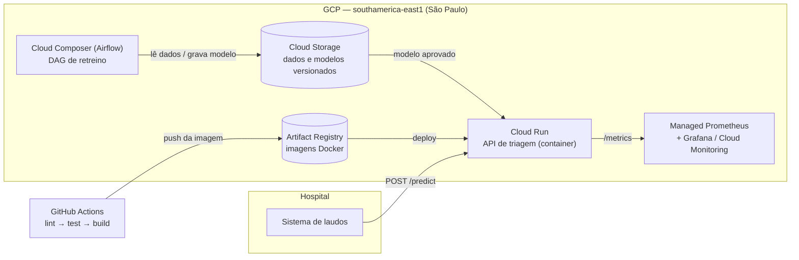
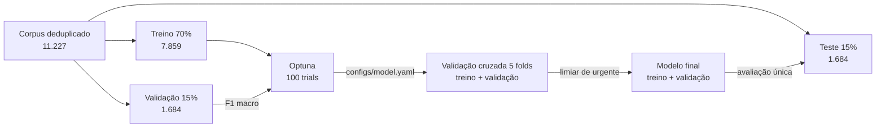
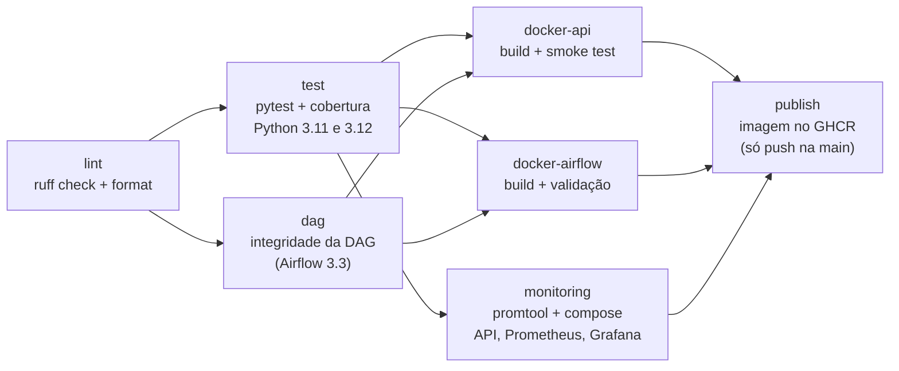
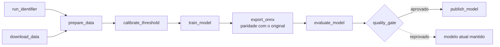
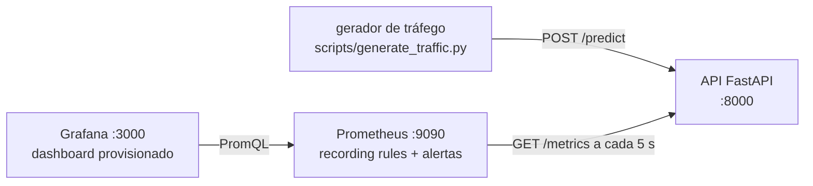
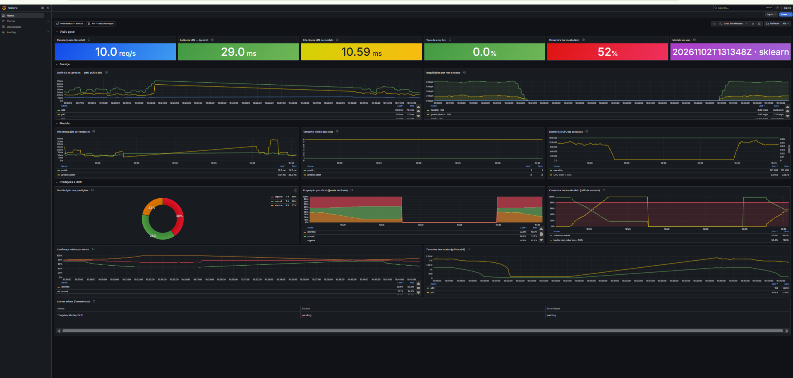
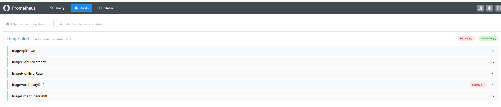

# Triagem Automática de Laudos Médicos — FIAP MLE10 Tech Challenge Fase 03

[](https://github.com/tiagotff/FIAP_MLE10_TC3/actions/workflows/ci.yml)

Serviço de NLP que classifica laudos médicos em **normal**, **atenção** ou **urgente**,
servido por uma API REST (FastAPI) empacotada em Docker. O projeto cobre o ciclo de
vida do modelo em produção: decisão arquitetural de deploy em nuvem, CI/CD, orquestração
de retreino, monitoramento e otimização de latência.

> 🎥 **Vídeo de apresentação (STAR, até 5 min):** [assistir no Google Drive](https://drive.google.com/file/d/1GXd1q_u_CsiTa6vCCkY2h_39JR3yi4uz/view?usp=sharing)
>
> 📄 Uso pretendido, métricas, limitações e considerações éticas do modelo estão
> resumidos no [Model Card](MODEL_CARD.md).

## Quickstart

Sequência única, do zero, para quem acabou de clonar o repositório. Cada comando assume
que você está na pasta raiz do projeto e usa **Git Bash** (Linux/macOS: mesmos
comandos). Há dois caminhos para rodar a API — **local com Poetry** ou **somente
Docker** —, um terceiro para o **retreino orquestrado pelo Airflow** e um quarto para a
**stack de monitoramento**.

> Pré-requisitos: Python 3.11 ou 3.12, [Poetry](https://python-poetry.org/) 2.x e
> Docker. Para o caminho só com Docker, basta o Docker.

### Opção A — Local (Poetry)

Você vai precisar de **2 terminais abertos ao mesmo tempo**: um para a API e outro para
enviar requisições.

**Terminal 1** — do clone até a API rodando:

```bash
# 1. Clonar e entrar na pasta
git clone https://github.com/tiagotff/FIAP_MLE10_TC3.git
cd FIAP_MLE10_TC3

# 2. Criar o ambiente virtual (Python 3.12) e instalar as dependências
poetry config virtualenvs.in-project true
poetry env use 3.12
poetry install

# 3. Copiar o template de variáveis de ambiente
cp .env.example .env

# 4. Conferir a qualidade do código e rodar os testes
poetry run ruff check .
poetry run pytest

# 5. Baixar o corpus (commit fixado + verificação SHA-256)
poetry run python -m triage.data.download

# 6. Treinar: deduplicação, divisão 70/15/15, limiar calibrado e avaliação no teste
poetry run python -m triage.training.train

# 6b. Exportar para ONNX (verifica a paridade com o modelo original)
poetry run python -m triage.optimization.export_onnx

# 7. Subir a API — deixe este terminal aberto e rodando
poetry run uvicorn triage.api.main:app --port 8000
```

Espere aparecer `Application startup complete` antes de seguir. **Não digite mais nada
neste terminal**: ele precisa continuar rodando. A documentação interativa fica em
<http://localhost:8000/docs>.

**Terminal 2** — novo terminal, com a API do Terminal 1 ainda rodando:

```bash
# 1. Entrar na pasta
cd FIAP_MLE10_TC3

# 2. Verificar se o serviço está pronto e ver o modelo carregado
curl http://localhost:8000/ready
curl http://localhost:8000/model

# 3. Classificar um laudo
curl -X POST http://localhost:8000/predict \
  -H "Content-Type: application/json" \
  -d '{"text": "Patient admitted with acute chest pain radiating to the left arm, ST-segment elevation and elevated troponin levels."}'

# 4. Classificar um lote de laudos
curl -X POST http://localhost:8000/predict/batch \
  -H "Content-Type: application/json" \
  -d '{"texts": ["acute ischemic stroke with hemiparesis", "gastric ulcer endoscopy follow up"]}'

# 5. Medir a latência (1.000 requisições)
poetry run python scripts/benchmark_api.py --requests 1000 --warmup 100

# 6. Comparar a latência do modelo original (scikit-learn) com o ONNX
poetry run python -m triage.benchmark.compare
```

A API local usa o backend definido em `INFERENCE_BACKEND` no `.env` (`sklearn` por
padrão). Para servir o modelo ONNX, troque para `onnx` ou suba com
`INFERENCE_BACKEND=onnx poetry run uvicorn triage.api.main:app --port 8000`.

Para encerrar, volte ao Terminal 1 e aperte `Ctrl+C`.

Opcional: `poetry run python -m triage.training.tune` refaz a busca de hiperparâmetros
com o Optuna (~2 min) e regrava `configs/model.yaml`.

### Opção B — Somente Docker

A imagem baixa os dados, treina o modelo e o exporta para ONNX durante o build, então não
é preciso Python nem Poetry na máquina. O container serve o modelo **ONNX** por padrão
(`-e INFERENCE_BACKEND=sklearn` serve o original):

```bash
# 1. Clonar e entrar na pasta
git clone https://github.com/tiagotff/FIAP_MLE10_TC3.git
cd FIAP_MLE10_TC3

# 2. Construir a imagem (treina o modelo; leva alguns minutos)
docker build -t triage-api:latest .

# 3. Subir o container
docker run -d --name triage-api -p 8000:8000 triage-api:latest

# 4. Testar
curl http://localhost:8000/ready
curl -X POST http://localhost:8000/predict \
  -H "Content-Type: application/json" \
  -d '{"text": "Patient admitted with acute chest pain radiating to the left arm, ST-segment elevation and elevated troponin levels."}'

# 5. Conferir a saúde do container (o healthcheck roda a cada 30 s)
sleep 35
docker ps

# 6. Encerrar
docker rm -f triage-api
```

Resultado esperado em ambos os caminhos: `"label":"urgente"` no `/predict` e, no treino,
`[teste/decision_policy] acurácia=0.8040 f1_macro=0.7763 recall_urgente=0.8466`.

### Opção C — Retreino com Airflow

```bash
# 1. Subir o Airflow (constrói a imagem na primeira vez; leva alguns minutos)
docker compose -f airflow/docker-compose.yml up -d --build

# 2. Abrir http://localhost:8080 (sem login), ativar a DAG `triage_retraining`
#    e clicar em "Trigger". Ou, pelo terminal:
docker compose -f airflow/docker-compose.yml exec airflow airflow dags unpause triage_retraining
docker compose -f airflow/docker-compose.yml exec airflow airflow dags trigger triage_retraining

# 3. Ao final, o modelo aprovado pelo quality gate está em models/ (e arquivado em
#    models/archive/<versão>/)
ls models models/archive

# 4. Encerrar
docker compose -f airflow/docker-compose.yml down
```

Detalhes em [Pipeline de retreino (Airflow)](#pipeline-de-retreino-airflow).

### Opção D — Monitoramento (API + Prometheus + Grafana)

```bash
# 1. Subir a stack (constrói a imagem da API na primeira vez; leva alguns minutos)
docker compose up -d --build

# 2. Gerar tráfego: 3 min de laudos normais e 5 min de laudos em português (drift)
docker compose run --rm traffic --plan normal:180,drift:300

# 3. Acompanhar (em outra aba do navegador, enquanto o tráfego roda)
#    Grafana:    http://localhost:3000   (dashboard abre direto; edição: admin/admin)
#    Prometheus: http://localhost:9090/alerts
#    Métricas:   http://localhost:8000/metrics

# 4. (Opcional) Verificar a stack inteira automaticamente (só usa a biblioteca padrão)
poetry run python scripts/smoke_monitoring.py

# 5. Encerrar (o -v apaga também o histórico do Prometheus e do Grafana)
docker compose down -v
```

Detalhes em [Monitoramento (Prometheus + Grafana)](#monitoramento-prometheus--grafana).

> ⚠️ **Windows:** se `poetry env use 3.12` falhar, aponte o executável diretamente:
> `poetry env use "$(py -3.12 -c 'import sys; print(sys.executable)')"`. Se o `poetry`
> apresentar erros de importação ao rodar qualquer comando, reinstale-o com
> `pipx uninstall poetry && pipx install poetry`. No Git Bash, comandos que passam um
> caminho absoluto do container (ex.: `docker compose exec airflow /opt/triage/...`)
> precisam do prefixo `MSYS_NO_PATHCONV=1`; sem ele, o Git Bash converte o caminho para
> `C:/Program Files/Git/...` e o comando falha.

---

## Sumário

- [Quickstart](#quickstart)
- [Contexto do problema](#contexto-do-problema)
- [Decisão arquitetural de deploy](#decisão-arquitetural-de-deploy)
- [Dados e rotulagem de urgência](#dados-e-rotulagem-de-urgência)
- [Protocolo de treino e otimização](#protocolo-de-treino-e-otimização)
- [Desempenho do modelo](#desempenho-do-modelo)
- [Latência baseline](#latência-baseline)
- [CI/CD (GitHub Actions)](#cicd-github-actions)
- [Pipeline de retreino (Airflow)](#pipeline-de-retreino-airflow)
- [Monitoramento (Prometheus + Grafana)](#monitoramento-prometheus--grafana)
- [Otimização de latência (ONNX Runtime)](#otimização-de-latência-onnx-runtime)
- [Estrutura do repositório](#estrutura-do-repositório)
- [Como executar](#como-executar)
- [API](#api)
- [Qualidade de código e testes](#qualidade-de-código-e-testes)
- [Etapas do projeto](#etapas-do-projeto)
- [Licença e atribuição](#licença-e-atribuição)

## Contexto do problema

Um hospital de referência recebe um fluxo contínuo de laudos em texto. Quando a fila é
processada por ordem de chegada, um laudo com achado crítico (ex.: sinais de infarto ou
AVC) pode esperar atrás de dezenas de exames de rotina. A triagem automática reordena a
fila pela urgência estimada, para que a equipe clínica veja primeiro o que não pode
esperar. O modelo **apoia** a priorização; a decisão clínica continua sendo humana.

## Decisão arquitetural de deploy

### Real-time ou batch?

| Critério | Real-time (API síncrona) | Batch (lotes agendados) |
|---|---|---|
| Valor da resposta | Alto: a prioridade é útil assim que o laudo é emitido | Baixo: um laudo urgente pode esperar até a próxima janela |
| Volume por requisição | 1 laudo, ~180 palavras | Muitos laudos de uma vez |
| Custo computacional | Inferência de ~1 ms em CPU, sem GPU | Eficiente, mas o ganho é irrelevante nesse custo |
| Integração | Sistema de laudos chama a API ao emitir o exame | Exige fila intermediária e janela de processamento |

**Decisão:** inferência **em tempo real** via API REST para a triagem, e processamento
**batch** apenas para o que não é sensível ao tempo: retreino do modelo e reprocessamento
histórico. O modelo é leve (TF-IDF + regressão logística), então CPU é suficiente e o
gargalo de latência tende a ser rede/serialização, não o modelo.

### Nuvem escolhida: Google Cloud Platform



| Componente | Serviço GCP | Justificativa |
|---|---|---|
| Serviço de inferência | **Cloud Run** | Container stateless, escala automática por requisição, HTTPS e IAM nativos. `min-instances=1` elimina *cold start* — requisito para um fluxo de urgência. |
| Imagens | Artifact Registry | Destino do `docker build` do CI/CD, com varredura de vulnerabilidades. |
| Dados e modelos | Cloud Storage | Versionamento de objetos; o retreino grava o modelo e a API carrega a versão aprovada. |
| Retreino | Cloud Composer (Airflow gerenciado) | Mesma DAG desenvolvida localmente roda sem reescrita. |
| Observabilidade | Managed Service for Prometheus + Grafana | Reaproveita a instrumentação `prometheus_client` e os dashboards locais. |

**Alternativas avaliadas:**

| Alternativa | Por que não foi a escolha principal |
|---|---|
| Vertex AI Endpoints | Mantém nós sempre ligados (custo maior) e brilha com GPU/modelos grandes — não é o caso de um modelo de ~1 MB. |
| GKE (Kubernetes) | Controle total, mas exige operar cluster; desproporcional para um único serviço. |
| Cloud Functions | Menor controle de runtime e *cold start* mais frequente. |
| AWS (App Runner / ECS Fargate) e Azure (Container Apps) | Equivalentes técnicos ao Cloud Run; a escolha do GCP se deve à região São Paulo disponível, ao modelo de cobrança por requisição e à continuidade com a stack já usada pela equipe. |

**Segurança e conformidade (LGPD):** laudos são dados pessoais sensíveis de saúde. Por
isso: região `southamerica-east1`; serviço sem acesso público (autenticação IAM ou
acesso via VPC/Serverless VPC Access a partir do sistema hospitalar); TLS em trânsito;
a API **não registra o texto dos laudos em logs** — apenas métricas agregadas e metadados
da predição.

## Dados e rotulagem de urgência

**Fonte:** [Medical Abstracts Text Classification Corpus](https://github.com/sebischair/Medical-Abstracts-TC-Corpus)
(Schopf, Braun & Matthes, 2023) — 14.438 registros de resumos clínicos em inglês,
distribuídos em dois arquivos (treino e teste) e 5 classes de condição do paciente.

### Mapeamento condição → urgência

O corpus rotula **condição**, não urgência. Para atender ao cenário de triagem, as 5
condições foram agrupadas em 3 níveis pelo critério *tempo até dano irreversível caso o
laudo não seja priorizado*:

| Condição original | Urgência | Racional |
|---|---|---|
| Cardiovascular diseases | **urgente** | Eventos tempo-dependentes (IAM, dissecção, arritmias graves) |
| Nervous system diseases | **urgente** | Eventos tempo-dependentes (AVC, hemorragia intracraniana) |
| Neoplasms | **atenção** | Exige encaminhamento prioritário, raramente minuto-dependente |
| Digestive system diseases | **atenção** | Acompanhamento prioritário |
| General pathological conditions | **normal** | Sem sinal específico de gravidade aguda |

O mapeamento é declarativo e está em [`configs/data.yaml`](configs/data.yaml). O download
fixa um commit do repositório de origem e valida o SHA-256 de cada arquivo.

### Qualidade dos dados: duplicatas e vazamento

A análise exploratória revelou dois problemas no corpus original:

- **3.211 registros duplicados.** Um resumo associado a várias condições aparece uma vez
  para cada uma delas. Restam **11.227 textos únicos**, dos quais **2.681 têm rótulos de
  urgência conflitantes** — o mesmo texto marcado, por exemplo, como `normal` e `urgente`.
- **Vazamento na divisão oficial.** **1.010 textos do arquivo de teste também estão no
  arquivo de treino.** Avaliar nessa divisão mede, em parte, memorização.

Tratamento adotado:

1. Os dois arquivos são unidos e cada texto passa a aparecer **uma única vez**.
2. Textos com rótulos conflitantes recebem o **mais urgente** — regra conservadora de
   triagem: na dúvida, prioriza-se o paciente.
3. O corpus deduplicado é redividido de forma **estratificada e reprodutível (seed 42)**
   em **70% treino / 15% validação / 15% teste**.

| Conjunto | Laudos | normal | atencao | urgente |
|---|---|---|---|---|
| Treino (70%) | 7.859 | 1.676 | 2.838 | 3.345 |
| Validação (15%) | 1.684 | 359 | 608 | 717 |
| Teste (15%) | 1.684 | 359 | 608 | 717 |
| **Total** | **11.227** | 2.394 (21%) | 4.054 (36%) | 4.779 (43%) |

A proporção 70/15/15 reserva ~1.700 laudos para validação e para teste, o que dá
estimativas estáveis nas duas etapas (o recall de `urgente` no teste, por exemplo, é
medido sobre 717 laudos). O desbalanceamento é tratado com `class_weight="balanced"`.

### Limitações

- **Idioma.** O corpus está em inglês e o modelo só entende inglês. Em laudos em
  português, apenas 18–29% dos termos existem no vocabulário do TF-IDF; a confiança cai
  (de 0,70 para 0,40 no caso de infarto) e há troca de classe (um laudo de úlcera gástrica
  passa de `atencao` para `normal`). Para o cenário de um hospital brasileiro, é preciso
  retreinar com laudos em português rotulados por especialistas, mantendo a mesma
  arquitetura e o mesmo protocolo. O teste completo está no [Model Card](MODEL_CARD.md#limitações).
- **Domínio.** Os textos são resumos de artigos científicos, não laudos de casos
  individuais; o desempenho precisa ser medido em dados do próprio hospital antes de uso real.
- **Rótulo *proxy*.** A urgência é definida no nível da doença, não do caso (um laudo
  cardiológico de rotina recebe `urgente`). Rótulos de triagem feitos por especialistas
  eliminariam essa limitação.
- **Classe `normal`.** Vem da categoria heterogênea *general pathological conditions*,
  que se sobrepõe às demais, e por isso é a classe mais difícil.

## Protocolo de treino e otimização



1. **Busca de hiperparâmetros com Optuna** (`python -m triage.training.tune`). Cada
   trial treina no **treino** e é avaliado na **validação**; o teste nunca participa. O
   amostrador TPE (semente fixa) explora 100 combinações de TF-IDF + classificador
   (Regressão Logística ou Complement Naive Bayes), maximizando o F1 macro. A melhor
   configuração é gravada em [`configs/model.yaml`](configs/model.yaml), versionado: o
   treino é determinístico a partir dela, e a busca é um passo offline. O espaço de
   busca fica em [`configs/tuning.yaml`](configs/tuning.yaml) e o histórico completo em
   [`reports/tuning/`](reports/tuning/).
2. **Espaço de busca compatível com ONNX.** Só entram opções do TF-IDF com conversão
   exata para ONNX Runtime (unigramas, stop words; sem `strip_accents`, que o conversor
   não suporta). O modelo final foi convertido em teste: **100% de concordância** de
   rótulos com o scikit-learn e diferença máxima de probabilidade de ~2·10⁻⁷, o que
   preserva o comportamento na etapa de otimização de latência.
3. **Limiar de decisão para `urgente`, calibrado fora da validação do Optuna.** Em
   triagem, deixar passar um laudo urgente custa muito mais do que um alarme falso. Em
   vez de escolher sempre a classe mais provável (argmax), o modelo classifica como
   `urgente` sempre que `P(urgente) ≥ limiar`. O limiar é o **maior valor que garante
   recall ≥ 0,85** nas probabilidades **out-of-fold** de uma validação cruzada
   estratificada de 5 folds sobre treino + validação — cada laudo é pontuado por um
   modelo que não o viu. Calibrar na própria validação usada pelo Optuna produziria
   probabilidades otimistas: nos testes, esse caminho levou a um limiar mais alto e a
   recall de apenas 0,805 no teste, abaixo da meta.
4. **Modelo final em treino + validação.** Com hiperparâmetros e limiar definidos, o
   modelo é reajustado em 85% dos dados, e o **teste (15%) é usado uma única vez**.

Os parâmetros do protocolo (frações, folds, meta de recall) ficam em
[`configs/training.yaml`](configs/training.yaml).

**Configuração escolhida pelo Optuna:** TF-IDF com 30 mil termos, `min_df=1`,
`max_df≈0,55`, sem `sublinear_tf` + Regressão Logística com `C≈2,31` e
`class_weight="balanced"`. A Regressão Logística venceu a busca (melhor F1 macro na
validação: 0,817, contra 0,759 do Naive Bayes), e os melhores trials formam um platô
(F1 ≈ 0,813–0,817 com 30 a 80 mil termos), indicando convergência. **Limiar calibrado:**
0,376.

## Desempenho do modelo

Avaliação no **teste** (1.684 laudos nunca vistos), comparando a decisão por argmax com a
política de limiar usada em produção:

| Métrica | Argmax | **Limiar (produção)** |
|---|---|---|
| Acurácia | 0,795 | **0,804** |
| F1 macro | 0,772 | **0,776** |
| **Recall de `urgente`** | 0,796 | **0,847** |
| Precisão de `urgente` | 0,865 | 0,848 |
| Laudos urgentes não sinalizados | 146 | **110** |

O limiar **reduz em 25% os laudos urgentes que passariam despercebidos** (146 → 110), ao
custo de 20 alarmes falsos adicionais, e ainda **melhora** acurácia e F1 macro. O recall
no teste (0,847) ficou praticamente na meta definida na calibração (0,85), o que mostra
que a calibração out-of-fold generaliza.

Validação cruzada (5 folds, out-of-fold em treino + validação) com o limiar: acurácia
0,809, F1 macro 0,785, recall de `urgente` 0,850 — coerente com o teste.

Matriz de confusão no teste (política de limiar; linhas = real, colunas = previsto):

| | normal | atencao | urgente |
|---|---|---|---|
| **normal** | 222 | 56 | 81 |
| **atencao** | 55 | 525 | 28 |
| **urgente** | 78 | 32 | **607** |

| Classe | Precisão | Recall | F1 |
|---|---|---|---|
| normal | 0,625 | 0,618 | 0,622 |
| atencao | 0,856 | 0,863 | 0,860 |
| urgente | 0,848 | 0,847 | 0,847 |

O relatório completo (dados, decisão, validação cruzada e teste, nas duas políticas)
fica em [`reports/model/metrics.json`](reports/model/metrics.json).

## Latência baseline

Medida com [`scripts/benchmark_api.py`](scripts/benchmark_api.py): 1.000 requisições
sequenciais a `POST /predict` com laudos reais, após 100 requisições de aquecimento, com
o servidor uvicorn em 1 worker e o modelo original (scikit-learn). A comparação com o
modelo otimizado está em
[Otimização de latência (ONNX Runtime)](#otimização-de-latência-onnx-runtime).

**Métrica de referência: p99.** A latência é avaliada pelo percentil 99 — o tempo que
cobre 99 de cada 100 laudos —, e não pela média ou pela mediana. Em uma fila de triagem,
o que importa é o pior caso frequente: uma média baixa pode esconder laudos urgentes
esperando muito mais que o normal. O p99 é a métrica usada para comparar o modelo
original com o otimizado (Etapa 4) e para o painel de latência do monitoramento
(Etapa 3); média, p50 e p95 aparecem como contexto.

| Ambiente | Medida | **p99** | Média | p50 | p95 | Vazão |
|---|---|---|---|---|---|---|
| Local (Linux, Python 3.12) | Ponta a ponta | **6,79 ms** | 3,56 ms | 3,42 ms | 4,60 ms | ~281 req/s |
| Local (Linux, Python 3.12) | Inferência do modelo | **2,02 ms** | 1,21 ms | 1,13 ms | 1,60 ms | — |
| Docker Desktop (Windows) | Ponta a ponta | **31,08 ms** | 14,34 ms | 15,99 ms | 27,88 ms | ~70 req/s |
| Docker Desktop (Windows) | Inferência do modelo | **3,43 ms** | 1,20 ms | 1,01 ms | 2,21 ms | — |

No p99, a inferência do modelo fica entre 2 e 3,5 ms, praticamente igual dentro e fora
do container. A diferença ponta a ponta (6,8 ms local contra 31,1 ms no container) vem
da camada de rede do Docker Desktop no Windows (VM do WSL2 e encaminhamento de porta):
no container, o modelo responde por cerca de 11% do p99 ponta a ponta. Isso orienta a
etapa de otimização: converter o modelo para ONNX Runtime reduz uma parcela pequena da
latência total, e o ganho relevante em produção depende também da infraestrutura de rede
(no Cloud Run não há essa camada de virtualização). As duas medições usam o modelo
final. Os relatórios completos ficam em [`reports/latency/`](reports/latency/).

Para medir contra o container:

```bash
docker run -d --name triage-api -p 8000:8000 triage-api:latest
poetry run python scripts/benchmark_api.py --requests 1000 --warmup 100 \
    --label baseline-docker --output reports/latency/baseline_docker.json
```

## CI/CD (GitHub Actions)

O workflow [`.github/workflows/ci.yml`](.github/workflows/ci.yml) roda a cada push e pull
request na `main` (e manualmente, via *workflow_dispatch*):



| Job | O que garante |
|---|---|
| `lint` | Código sem erros de lint e formatado (`ruff check` e `ruff format --check`) |
| `test` | Suíte completa de testes com cobertura, em Python 3.11 e 3.12; o relatório `coverage.xml` fica como artefato da execução |
| `dag` | A DAG é importada sem erros e mantém as tasks e a ordem esperadas (`airflow/tests`) |
| `docker-api` | A imagem da API é construída (treinando e exportando o modelo para ONNX), sobe, responde em `/ready`, classifica um laudo de infarto como `urgente` e dá os mesmos rótulos com os backends ONNX e scikit-learn |
| `docker-airflow` | A imagem do Airflow é construída, o venv de ML importa o projeto e a DAG é carregada dentro da imagem |
| `monitoring` | Configuração e regras do Prometheus válidas e com testes unitários aprovados (`promtool`); a stack do Docker Compose sobe, recebe tráfego e passa no [smoke test de monitoramento](#verificação-automatizada) |
| `publish` | Em push na `main`, publica a imagem da API em `ghcr.io/tiagotff/triage-api` com as tags `latest` e o SHA do commit |

Os jobs seguintes só rodam se os anteriores passarem, e os builds Docker usam cache do
GitHub Actions. A publicação no GHCR é a etapa de entrega contínua: em produção, o Cloud
Run seria atualizado a partir dessa imagem (ver
[Decisão arquitetural](#decisão-arquitetural-de-deploy)).

## Pipeline de retreino (Airflow)

A DAG [`triage_retraining`](airflow/dags/triage_retraining.py) automatiza o retreino com o
mesmo protocolo do treino manual, em etapas independentes:



| Task | Etapa ([`triage.pipeline.steps`](src/triage/pipeline/steps.py)) |
|---|---|
| `download_data` | Baixa o corpus com commit e SHA-256 fixados (idempotente) |
| `prepare_data` | Deduplica e divide em treino/validação/teste (70/15/15) |
| `calibrate_threshold` | Calibra o limiar de `urgente` com validação cruzada em treino + validação |
| `train_model` | Treina o modelo final em treino + validação |
| `export_onnx` | Exporta para ONNX e falha se o modelo exportado não reproduzir o original em todo o corpus ([detalhes](#otimização-de-latência-onnx-runtime)) |
| `evaluate_model` | Avalia no teste, com argmax e com a política de limiar |
| `quality_gate` | Falha a execução se F1 macro < 0,74 ou recall de `urgente` < 0,80 no teste |
| `publish_model` | Arquiva a versão em `models/archive/<versão>/` e troca os modelos em uso (`model.joblib` e `model.onnx`) de forma atômica |

**Decisões de projeto:**

- **Ambiente de ML isolado.** As constraints oficiais do Airflow 3.3 fixam scikit-learn
  1.9 e pandas 3, enquanto a API usa scikit-learn 1.7. Para que o modelo seja treinado
  com exatamente as versões que vão carregá-lo, as tasks de ML rodam com
  `@task.external_python` num venv próprio, instalado a partir do **mesmo `poetry.lock`**
  da API ([`airflow/Dockerfile`](airflow/Dockerfile)).
- **Etapas idempotentes e isoladas.** Cada task lê e grava arquivos em
  `artifacts/runs/<run_id>/`; pelo XCom trafegam só resumos (tamanhos, limiar, métricas).
  Qualquer etapa pode ser repetida sozinha pela interface do Airflow.
- **Quality gate antes de publicar.** Um retreino que piore o modelo é barrado e o modelo
  em produção continua o mesmo. Os mínimos ficam em
  [`configs/training.yaml`](configs/training.yaml).
- **Publicação atômica e versionada.** O modelo novo é escrito em arquivo temporário e
  trocado com `os.replace`, então a API nunca lê um artefato pela metade; cada versão
  publicada fica arquivada para rollback.
- **Agendamento semanal** (`@weekly`), sem *catchup* e com no máximo uma execução por vez.

A mesma sequência roda sem Airflow, útil para desenvolvimento:

```bash
poetry run python -m triage.pipeline.run
```

A DAG foi validada com `airflow dags test` e pelo scheduler do Airflow 3.3.2 (execuções
agendada e manual): as tasks concluem com sucesso e o modelo publicado tem as mesmas
métricas do treino manual (F1 macro 0,776; recall de `urgente` 0,847). Com a Etapa 4, a
DAG passou a ter 9 tasks, incluindo a exportação para ONNX, validada da mesma forma.

## Monitoramento (Prometheus + Grafana)

A API expõe métricas em `GET /metrics` (formato Prometheus, via `prometheus_client`). O
[`docker-compose.yml`](docker-compose.yml) da raiz sobe a API, o Prometheus (coleta a cada
5 s e avalia as regras) e o Grafana, já com datasource e dashboard provisionados:



### Métricas expostas

| Métrica | Tipo | O que mostra |
|---|---|---|
| `triage_http_requests_total{method, route, status}` | Counter | Volume e erros por rota (template da rota, não a URL) |
| `triage_http_request_duration_seconds{method, route}` | Histogram | Latência ponta a ponta; base do **p99** |
| `triage_http_requests_in_progress` | Gauge | Requisições em andamento |
| `triage_inference_duration_seconds{endpoint}` | Histogram | Tempo só do modelo, sem rede e serialização |
| `triage_batch_size{endpoint}` | Histogram | Laudos por chamada de inferência |
| `triage_predictions_total{label}` | Counter | Distribuição das predições (`normal`, `atencao`, `urgente`) |
| `triage_prediction_confidence{label}` | Histogram | Confiança do rótulo previsto |
| `triage_vocabulary_coverage_ratio` | Histogram | Fração dos termos do laudo que o modelo reconhece (drift) |
| `triage_input_text_length_chars` | Histogram | Tamanho dos laudos recebidos |
| `triage_model_info{model_version, backend}` | Gauge | Versão do modelo em uso |
| `process_*` | — | CPU, memória e descritores do processo da API |

**Por que cobertura de vocabulário?** Em produção não há rótulo verdadeiro na hora da
predição, então a acurácia não pode ser monitorada em tempo real. A cobertura é um sinal
de drift que não precisa de rótulos: laudos do domínio têm ~97% dos termos no vocabulário
do TF-IDF (1% abaixo de 87,5%), enquanto laudos em português ficam em ~20–30% — o caso
crítico descrito no [Model Card](MODEL_CARD.md#idioma-o-modelo-só-entende-inglês).

As métricas usam o *template* da rota para manter a cardinalidade fixa, o próprio
`/metrics` não entra nas séries de tráfego e **nenhuma métrica carrega texto de laudo**
(LGPD). Cada instância da aplicação tem o próprio registry, o que isola os testes.

### Dashboard

O dashboard [`triage.json`](monitoring/grafana/dashboards/triage.json) abre como página
inicial do Grafana, sem login, e atualiza a cada 10 s. São 17 painéis em quatro blocos:

| Bloco | Painéis |
|---|---|
| Visão geral | Requisições/s · **latência p99 de `/predict`** · inferência p99 do modelo · taxa de erro 5xx · cobertura de vocabulário · modelo em uso |
| Serviço | Latência p50/p95/**p99** com a linha do limite de alerta · requisições por rota e status |
| Modelo | Inferência p99 por endpoint · tamanho médio dos lotes · memória e CPU do processo |
| Predições e drift | Distribuição das predições · proporção por rótulo ao longo do tempo · cobertura de vocabulário · confiança média por rótulo · tamanho dos laudos · alertas ativos |

### Regras e alertas

As consultas do dashboard e dos alertas vêm das mesmas *recording rules*
([`rules.yml`](monitoring/prometheus/rules.yml)) — o p99, por exemplo, tem uma única
definição. Os alertas aparecem em <http://localhost:9090/alerts> e na tabela do dashboard:

| Alerta | Condição | Severidade |
|---|---|---|
| `TriageApiDown` | Prometheus sem conseguir coletar a API por 1 min | critical |
| `TriageHighErrorRate` | Mais de 5% de respostas 5xx por 2 min | critical |
| `TriageHighP99Latency` | p99 de `/predict` acima de 100 ms por 2 min | warning |
| `TriageVocabularyDrift` | Cobertura média (5 min) abaixo de 80% por 2 min | warning |
| `TriageUrgentShareShift` | Proporção de `urgente` fora de 28%–58% por 5 min (esperado ~43%) | info |

As regras têm testes unitários com o `promtool`
([`rules_test.yml`](monitoring/prometheus/rules_test.yml)), executados no CI. Nesta stack
local não há Alertmanager; em produção, ele faria o roteamento (e-mail, Slack, plantão).

### Demonstração de drift

O [gerador de tráfego](scripts/generate_traffic.py) executa um plano de fases
`cenário:segundos` — `normal` (laudos do conjunto de teste, 20% em lote), `drift` (laudos em
português) e `errors` (20% de requisições inválidas):

```bash
docker compose run --rm traffic --plan normal:180,drift:300
# ou, com o ambiente Poetry: poetry run python scripts/generate_traffic.py --plan ...
```

Resultado medido com a stack local (15 req/s, 90 s normal → 30 s com erros → drift):

| Sinal | Fase normal | Fase de drift (português) |
|---|---|---|
| Cobertura de vocabulário (média de 1 min) | 97% | **17%** |
| Proporção de `normal` nas predições | 18% | **37%** |
| Confiança média em `normal` | 0,74 | **0,47** |
| Alerta `TriageVocabularyDrift` | inativo | *pending* em ~1 min, **disparado em ~3 min** |

A fase de drift reproduz o risco descrito no Model Card: sem reconhecer os termos, o
modelo empurra laudos para `normal`, com confiança baixa — e o alerta dispara antes que
qualquer rótulo revisado estivesse disponível.

Dashboard no Docker Desktop (Windows), durante a fase de drift. A cobertura de vocabulário
caiu para 52% e segue descendo, e o alerta `TriageVocabularyDrift` aparece como
*pending*:



Um minuto depois, o alerta passa a *firing* no Prometheus:



### Servindo o modelo retreinado

Por padrão, a API serve o modelo treinado no build da imagem. Para servir o modelo
publicado pela [DAG de retreino](#pipeline-de-retreino-airflow) em `./models`, sem
rebuild, combine o arquivo [`docker-compose.retrained.yml`](docker-compose.retrained.yml):

```bash
docker compose -f docker-compose.yml -f docker-compose.retrained.yml up -d
# após um novo retreino aprovado pelo quality gate:
docker compose -f docker-compose.yml -f docker-compose.retrained.yml restart api
```

O painel **Modelo em uso** mostra a versão servida, fechando o ciclo
retreino → publicação → serviço → monitoramento.

### Verificação automatizada

[`scripts/smoke_monitoring.py`](scripts/smoke_monitoring.py) confere a stack de ponta a
ponta: API expondo métricas, Prometheus coletando a API com as regras carregadas e sem
erro, recording rules com dados e, no Grafana, datasource saudável, dashboard provisionado
e **todas as consultas dos painéis executando sem erro**. O CI roda essa verificação a cada
push, depois de subir a stack com Docker Compose e gerar tráfego (job `monitoring`).

## Otimização de latência (ONNX Runtime)

**Técnica:** conversão do pipeline TF-IDF + Regressão Logística para **ONNX**, executado
com o **ONNX Runtime** ([`export_onnx.py`](src/triage/optimization/export_onnx.py) e
[`onnx_predictor.py`](src/triage/inference/onnx_predictor.py)). O modelo é o mesmo: só
muda o motor de execução, que roda em C++ e libera o GIL do Python durante a inferência.

```bash
poetry run python -m triage.optimization.export_onnx   # gera models/model.onnx
INFERENCE_BACKEND=onnx poetry run uvicorn triage.api.main:app --port 8000
```

### Conversão exata e portátil

| Decisão | Por quê |
|---|---|
| `lowercase` feito em Python, fora do grafo | O operador `StringNormalizer` do ONNX depende dos *locales* do sistema e falha em imagens Docker enxutas (`en_US.UTF-8` ausente). O `str.lower()` do Python é exatamente o que o scikit-learn usa, então o modelo fica portátil (Linux, Windows, Docker) sem perder paridade |
| Tokenizador com `[\p{L}\p{N}_]{2,}` | Equivalente RE2 do `token_pattern` do scikit-learn. O padrão do conversor só aceita ASCII e quebraria "torácica" em dois tokens |
| Espaço do Optuna restrito a opções conversíveis | Unigramas e analisador de palavras ([`tuning.yaml`](configs/tuning.yaml)); a exportação valida isso e falha com erro claro para opções sem conversão exata |
| Perfil de texto nos metadados do `.onnx` | Ordem das classes, stop words e vocabulário ficam no próprio arquivo: o backend ONNX mede a **cobertura de vocabulário** (sinal de drift do monitoramento) sem carregar o modelo scikit-learn |
| Sessão com 1 thread | Um laudo por chamada não ganha com paralelismo dentro do operador; uma thread evita disputa de CPU entre requisições simultâneas e protege o p99 |

**Paridade verificada antes de gravar o arquivo**, em todo o corpus (14.438
textos): **100% dos rótulos iguais** e diferença máxima de probabilidade de 1,9·10⁻⁷. Se a
paridade falhar, o `.onnx` não é gravado — na DAG, a task `export_onnx` falha e nada é
publicado. Os dois backends usam os mesmos metadados e o mesmo limiar de decisão.

### Resultados: modelo isolado

[`python -m triage.benchmark.compare`](src/triage/benchmark/compare.py) mede os dois
backends pelo mesmo caminho da API (`load_predictor` + `predict`, com o limiar de
decisão), com 2.000 laudos do corpus, alternando os backends em rodadas
(Linux, Python 3.12, 2 vCPUs):

| Backend | Unitário — **p99** (p50) | Lote de 32 — **p99** (p50) | Carga do modelo | Artefato |
|---|---|---|---|---|
| scikit-learn | 2,483 ms (1,031 ms) | 7,49 ms (5,05 ms) | 254 ms | 1,00 MB |
| **ONNX Runtime** | **0,717 ms** (0,258 ms) | 9,06 ms (6,75 ms) | **22 ms** | 1,52 MB |

**No caso de uso real — um laudo por requisição — o ONNX reduz o p99 em
3,5x** (4,0x no p50) e carrega o modelo
11x mais rápido. Em lotes, o ONNX fica
~17% mais lento no p99: o operador `TfIdfVectorizer`
do ONNX produz uma matriz **densa** (lote × 30 mil termos), enquanto o scikit-learn usa
matriz esparsa. Como a [arquitetura escolhida](#real-time-ou-batch) é de inferência em
tempo real, laudo a laudo, o ONNX é o backend padrão.

### Resultados: API ponta a ponta

[`scripts/benchmark_api.py`](scripts/benchmark_api.py) contra o uvicorn local (1 worker),
1.000 requisições sequenciais e 2.000 com 8 clientes simultâneos (`--concurrency 8`):

| Carga | Medida | scikit-learn — p99 (p50) | **ONNX — p99 (p50)** | Variação no p99 |
|---|---|---|---|---|
| 1 cliente (sequencial) | Inferência do modelo | 2,73 ms (1,47) | **1,19 ms** (0,49) | −57% |
| 1 cliente (sequencial) | Ponta a ponta | 9,70 ms (5,59) | **9,60 ms** (4,02) | −1% |
| 1 cliente (sequencial) | Vazão | 174 req/s | **230 req/s** | +33% |
| 8 clientes simultâneos | Inferência do modelo | 16,49 ms (4,20) | **6,78 ms** (1,18) | −59% |
| 8 clientes simultâneos | Ponta a ponta | 65,10 ms (34,47) | **51,51 ms** (23,85) | −21% |
| 8 clientes simultâneos | Vazão | 223 req/s | **322 req/s** | +44% |

Sem concorrência, o ganho de ~1,5 ms do modelo fica diluído no custo de HTTP,
serialização e log de cada requisição. **Sob carga, o ONNX reduz o p99 do modelo em
~59% e o ponta a ponta em ~21%, com ~44% mais vazão**: como o
ONNX Runtime libera o GIL, as requisições simultâneas deixam de disputar o interpretador
Python. Relatórios completos em [`reports/latency/`](reports/latency/).

**No Docker Desktop (Windows)**, no mesmo ambiente do [baseline](#latência-baseline), a
mesma imagem com `INFERENCE_BACKEND=sklearn` e com o padrão `onnx`, 1.000 requisições com 8
clientes simultâneos:

| Medida | scikit-learn — p99 (p50) | **ONNX — p99 (p50)** | Variação no p99 |
|---|---|---|---|
| Inferência do modelo | 9,83 ms (2,77) | **6,79 ms** (1,40) | −31% |
| Ponta a ponta | 66,93 ms (29,89) | **44,19 ms** (22,51) | −34% |
| Vazão | 245 req/s | **332 req/s** | +36% |

O ganho se repete fora do Linux: **o p99 ponta a ponta cai um terço** no container, e a
vazão sobe mais de um terço com o mesmo hardware.

### E a quantização?

Foi avaliada e **não se aplica** a este modelo. A quantização dinâmica do ONNX Runtime
(`quantize_dynamic`) converte operadores `MatMul`/`Gemm` para INT8, mas o grafo exportado
não tem nenhum: são `Tokenizer`, `TfIdfVectorizer`, `Normalizer` e `LinearClassifier`. O
modelo quantizado sai idêntico ao original (mesmos operadores, mesmo tamanho). Com 1,5
MB e inferência abaixo de 1 ms, o gargalo não é aritmética de ponto flutuante, e sim
tokenização e alocação — justamente o que a execução em C++ do ONNX Runtime ataca.

### Onde o ONNX entra no projeto

- **Docker:** o build treina e exporta (com paridade), e a imagem sobe com
  `INFERENCE_BACKEND=onnx`; `-e INFERENCE_BACKEND=sklearn` serve o modelo original.
- **Airflow:** a DAG ganhou a task `export_onnx` entre o treino e a avaliação, e a
  publicação troca `model.joblib`, `model.onnx` e os metadados juntos.
- **CI:** o job `docker-api` sobe a imagem com os dois backends e exige rótulos iguais.
- **Monitoramento:** o painel **Modelo em uso** mostra o backend (`· onnx`), e
  `GET /model` informa o backend em uso.

## Estrutura do repositório

```
├── .github/workflows/ci.yml   # CI/CD: lint, testes, DAG, builds, monitoramento e publicação
├── airflow/
│   ├── dags/                  # DAG de retreino (triage_retraining)
│   ├── tests/                 # testes de integridade da DAG
│   ├── Dockerfile             # Airflow + venv de ML a partir do poetry.lock
│   └── docker-compose.yml     # Airflow standalone local
├── monitoring/
│   ├── prometheus/            # coleta, recording rules, alertas e testes das regras
│   └── grafana/               # datasource e dashboard provisionados
├── configs/
│   ├── data.yaml              # fonte, checksums, mapeamento e escala de urgência
│   ├── model.yaml             # melhor pipeline encontrado pelo Optuna (gerado)
│   ├── training.yaml          # divisão 70/15/15, calibração, decisão e quality gate
│   └── tuning.yaml            # espaço de busca e orçamento do Optuna
├── reports/
│   ├── latency/               # benchmarks de latência (baseline e sklearn x ONNX)
│   ├── model/                 # dados, decisão e métricas (validação cruzada e teste)
│   └── tuning/                # histórico de trials e resumo da busca
├── scripts/
│   ├── benchmark_api.py       # benchmark de latência do endpoint /predict
│   ├── generate_traffic.py    # tráfego sintético (normal, drift, erros)
│   └── smoke_monitoring.py    # verificação de ponta a ponta da stack de monitoramento
├── src/triage/
│   ├── api/                   # FastAPI: app, rotas, schemas, middleware, erros, logging
│   ├── benchmark/             # estatísticas de latência (p99) e comparação de backends
│   ├── config/                # Settings (pydantic-settings) e leitura de YAML
│   ├── data/                  # download, deduplicação e divisão estratificada
│   ├── inference/             # backends sklearn e ONNX, políticas de decisão (Strategy + Factory)
│   ├── models/                # Factory de pipelines TF-IDF + classificador
│   ├── monitoring/            # métricas Prometheus da API
│   ├── optimization/          # exportação para ONNX com verificação de paridade
│   ├── pipeline/              # etapas do retreino, quality gate e execução sem Airflow
│   └── training/              # Optuna, calibração OOF, treino, avaliação e artefatos
├── tests/                     # testes unitários e de API (pytest)
├── Dockerfile                 # multi-stage: treino → dependências → runtime
├── docker-compose.yml         # API + Prometheus + Grafana (+ gerador de tráfego)
├── docker-compose.retrained.yml  # serve o modelo publicado pela DAG (./models)
├── MODEL_CARD.md              # uso pretendido, métricas, limitações e ética do modelo
└── pyproject.toml             # dependências (Poetry) e configuração do ruff/pytest
```

## Como executar

### Pré-requisitos

- Python 3.11 ou 3.12
- [Poetry](https://python-poetry.org/) 2.x
- Docker

### Localmente (Poetry)

```bash
poetry env use 3.12
poetry install
cp .env.example .env

poetry run python -m triage.data.download      # baixa e valida o corpus
poetry run python -m triage.training.tune      # (opcional) refaz a busca do Optuna
poetry run python -m triage.training.train     # calibra o limiar, treina e avalia
poetry run python -m triage.optimization.export_onnx  # exporta para ONNX (paridade)
poetry run python -m triage.pipeline.run       # (alternativa) pipeline com quality gate
poetry run uvicorn triage.api.main:app --port 8000
```

A busca do Optuna leva cerca de 2 minutos e regrava `configs/model.yaml`. Sem ela, o treino
usa a configuração já versionada. Documentação interativa: <http://localhost:8000/docs>.

### Docker

A imagem treina o modelo durante o build (dados, configuração e seed fixados), então um
único comando gera um serviço funcional:

```bash
docker build -t triage-api:latest .
docker run -d --name triage-api -p 8000:8000 triage-api:latest
curl http://localhost:8000/ready
```

Para servir um modelo treinado fora do build, monte o diretório de artefatos (ou use o
[`docker-compose.retrained.yml`](#servindo-o-modelo-retreinado)):

```bash
docker run -d -p 8000:8000 -v "$(pwd)/models:/app/models:ro" triage-api:latest
```

A imagem final roda com usuário não-root, tem `HEALTHCHECK` em `/ready` e não inclui
Poetry, pandas, Optuna, dados de treino nem dependências de desenvolvimento.

## API

| Método | Rota | Descrição |
|---|---|---|
| `GET` | `/health` | *Liveness*: o processo responde (inclui se o modelo está carregado) |
| `GET` | `/ready` | *Readiness*: `200` somente com o modelo carregado; `503` caso contrário |
| `GET` | `/model` | Versão, backend (`onnx` ou `sklearn`), classificador, regra de decisão (limiar) e métricas de teste |
| `POST` | `/predict` | Classifica a urgência de um laudo |
| `POST` | `/predict/batch` | Classifica até 64 laudos em uma chamada, preservando a ordem |
| `GET` | `/metrics` | Métricas no formato Prometheus (ver [Monitoramento](#monitoramento-prometheus--grafana)) |
| `GET` | `/docs` | Swagger UI |

Exemplo:

```bash
curl -X POST http://localhost:8000/predict \
  -H "Content-Type: application/json" \
  -d '{"text": "Patient admitted with acute chest pain radiating to the left arm, ST-segment elevation and elevated troponin levels."}'
```

```json
{
  "label": "urgente",
  "confidence": 0.70,
  "probabilities": {"normal": 0.20, "atencao": 0.09, "urgente": 0.70},
  "model_version": "20261101T221821Z",
  "inference_ms": 1.2
}
```

`probabilities` segue sempre a ordem `normal`, `atencao`, `urgente`. O rótulo aplica o
limiar calibrado: um laudo é `urgente` sempre que `P(urgente) ≥ 0,376`, mesmo que outra
classe tenha probabilidade maior.

**Robustez e privacidade:**

- **Rastreabilidade:** toda resposta traz `X-Request-ID` (reaproveitado do cliente quando
  válido, ou gerado) e `X-Process-Time-Ms`. O access log registra método, rota, status,
  duração e request-id.
- **Privacidade (LGPD):** o texto dos laudos nunca é logado, e as respostas de erro de
  validação (`422`) informam o campo e o motivo **sem ecoar o conteúdo enviado**.
- **Erros previsíveis:** textos vazios, acima de 20.000 caracteres ou lotes fora de 1–64
  itens retornam `422`; sem modelo, as rotas de predição retornam `503`; falhas
  inesperadas retornam `500` com mensagem genérica e o `request_id`, sem detalhes internos.
- **Fail-fast:** se o artefato do modelo não puder ser carregado, a aplicação não sobe,
  em vez de aceitar tráfego sem modelo.

## Qualidade de código e testes

- **SOLID na prática:**
  - *Responsabilidade única:* download, deduplicação, divisão, tuning, calibração,
    treino, avaliação, inferência e API em módulos separados.
  - *Aberto/fechado:* classificadores, backends de inferência e políticas de decisão
    entram por registro (Factory), sem alterar quem os usa.
  - *Inversão de dependência:* a API depende do protocolo `UrgencyPredictor`, e o
    preditor recebe a `DecisionPolicy` por injeção. O backend ONNX entrou na Etapa 4 só
    com uma nova classe e uma entrada no registro de backends: nenhum endpoint mudou.
  - *Segregação de interfaces:* a cobertura de vocabulário é uma capacidade opcional
    (`CoverageAware`), separada do contrato de predição: um backend sem vocabulário
    exposto continua válido, apenas sem esse sinal de drift.
- **Padrões de projeto:** Factory (classificadores, preditores, políticas), Strategy
  (backend de inferência e regra de decisão) e injeção de dependência do preditor na
  aplicação FastAPI.
- **Clean code:** funções curtas e de responsabilidade única, type hints em todo o
  código, docstrings e mensagens de erro em português, configuração fora do código
  (YAML validado com Pydantic + `.env`).
- **Reprodutibilidade:** dependências travadas em `poetry.lock` e separadas por grupo
  (treino, tuning, API, dev); seeds fixas na divisão, na validação cruzada, no Optuna e
  nos modelos; dataset com commit e checksum fixados; divisões com tamanhos exatos
  (frações convertidas em contagens, sem erro de ponto flutuante).
- **Testes:** testes unitários e de API (pytest), incluindo garantias de privacidade (o
  texto do laudo não aparece em logs nem em erros); ferramentas `ruff` (lint +
  formatação) e `pre-commit`.

```bash
poetry run ruff check .
poetry run ruff format --check .
poetry run pytest --cov=triage
poetry run pre-commit install    # hooks executados a cada commit
```

## Etapas do projeto

| Etapa | Status | Entregáveis |
|---|---|---|
| 1. Decisão arquitetural e API inicial | ✅ Concluída | Decisão de deploy (esta documentação), API FastAPI em Docker, latência baseline |
| 2. CI/CD e pipeline de treino | ✅ Concluída | [Workflow GitHub Actions](#cicd-github-actions) (lint → testes → DAG → builds → GHCR) e [DAG Airflow](#pipeline-de-retreino-airflow) de retreino com quality gate |
| 3. Monitoramento | ✅ Concluída | [Métricas `prometheus_client`](#monitoramento-prometheus--grafana) (latência p99, erros, predições, drift), Docker Compose (API + Prometheus + Grafana), dashboard de 17 painéis, alertas testados com `promtool` e gerador de tráfego |
| 4. Otimização de latência | ✅ Concluída | [Modelo exportado para ONNX Runtime](#otimização-de-latência-onnx-runtime) com paridade de 100%, backend selecionável na API, exportação na DAG e comparação de latência p99 (modelo isolado e API sob carga) |
| Vídeo (STAR) | ✅ Concluída | [Apresentação de até 5 minutos](https://drive.google.com/file/d/1GXd1q_u_CsiTa6vCCkY2h_39JR3yi4uz/view?usp=sharing): situação, tarefa, ação e resultado |

## Licença e atribuição

Código sob licença [MIT](LICENSE).

O dataset é de Schopf, Braun & Matthes, *Evaluating Unsupervised Text Classification:
Zero-shot and Similarity-based Approaches* (NLPIR 2022, doi:
[10.1145/3582768.3582795](https://doi.org/10.1145/3582768.3582795)), distribuído sob
CC BY-SA 3.0. Os dados não são versionados neste repositório; são baixados da fonte
original.
